# Study With Me

一只住在你 Mac 桌面上的学习／工作陪伴桌宠。

它安静地待在桌面一角，替你记录今天陪了你多久、敲了多少次键、每种状态（工作、摸鱼、午休、开会……）各花了多少时间；双击它就能打开一本「陪伴手帐」，里面有提醒事项、学习打卡、统计图表和日记。

<p align="center">
  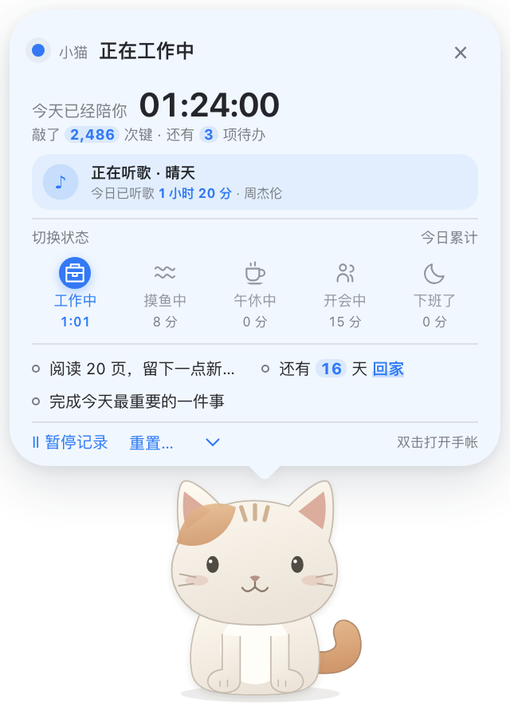
</p>

- 完全离线，所有记录只保存在你自己的电脑上，不联网、不上传。
- 只统计**按键次数**，从不记录你输入了什么内容。
- 免费开源（MIT 协议）。

> 目前只支持 **macOS**（需要 macOS 11 Big Sur 或更新版本）。

---

## 目录

- [安装](#安装)
  - [方式一：下载安装包（推荐）](#方式一下载安装包推荐)
  - [方式二：从源码运行](#方式二从源码运行)
- [第一次打开要做的事](#第一次打开要做的事)
- [怎么用](#怎么用)
- [功能介绍](#功能介绍)
- [你的数据存在哪里](#你的数据存在哪里)
- [常见问题](#常见问题)
- [卸载](#卸载)
- [开发者说明](#开发者说明)
- [使用本项目的代码](#使用本项目的代码)
- [第三方许可](#第三方许可)

---

## 安装

### 方式一：下载安装包（推荐）

1. 打开本仓库页面右侧的 **Releases**，找到最新版本。
2. 根据你的电脑下载对应的 `.dmg` 文件：
   - 苹果芯片（M1 / M2 / M3 / M4 等）：下载文件名带 `arm64` 的。
   - Intel 芯片：下载文件名**不带** `arm64` 的。
   - 不知道自己是哪种？点屏幕左上角  → **关于本机**，看「芯片」或「处理器」一栏：写着 Apple M… 的是苹果芯片，写着 Intel 的是 Intel 芯片。
3. 双击下载好的 `.dmg`，在弹出的窗口里把 **Study With Me** 图标拖进 **Applications（应用程序）** 文件夹。
4. 打开「访达 → 应用程序」，双击 **Study With Me**。

**第一次打开时，macOS 可能会提示「无法打开」或「无法验证开发者」。** 这是因为本项目是个人开源作品，没有购买苹果的开发者签名，并不是软件有问题。按下面的步骤放行一次即可，以后不会再问：

1. 在提示框里点 **完成**（或「取消」），不要点「移到废纸篓」。
2. 打开 **系统设置 → 隐私与安全性**，向下滚动到「安全性」部分。
3. 你会看到一行「已阻止使用 Study With Me……」，点旁边的 **仍要打开**，输入电脑密码确认。
4. 再次双击打开 Study With Me，在弹窗里点 **打开**。

> 如果提示的是「已损坏，无法打开」，请看[常见问题](#提示已损坏无法打开)。

### 方式二：从源码运行

适合想自己修改代码，或者 Releases 里还没有安装包的情况。只需要照着复制粘贴命令即可。

**第 1 步：安装 Node.js**

打开 <https://nodejs.org>，下载 **LTS（长期支持版）** 安装包，像普通软件一样双击安装。

**第 2 步：下载本项目代码**

在本仓库页面点绿色的 **Code** 按钮 → **Download ZIP**，下载后双击解压，得到一个 `study-with-me-main` 文件夹（可以把它放到「文稿」等任意位置）。

**第 3 步：打开「终端」并进入项目文件夹**

1. 按 `⌘ + 空格`，输入「终端」，回车打开。
2. 在终端里输入 `cd`，**再敲一个空格**，然后把刚才解压出的文件夹直接拖进终端窗口，按回车。

**第 4 步：安装依赖**

复制下面这行，粘贴到终端里，按回车，等它跑完（第一次需要几分钟）：

```bash
npm install
```

> 在国内下载很慢或失败时，可以改用国内镜像，先运行下面这行再重新 `npm install`：
>
> ```bash
> export npm_config_registry=https://registry.npmmirror.com ELECTRON_MIRROR=https://npmmirror.com/mirrors/electron/
> ```

**第 5 步：启动**

```bash
npm run dev
```

桌宠会出现在主屏幕的右下角。这种方式启动时终端窗口要一直开着，关掉终端桌宠也会退出。

如果想像普通软件一样安装，可以自己打包出安装包：

```bash
npm run dist:mac
```

完成后在项目里的 `dist` 文件夹中会出现 `.dmg` 文件，按[方式一](#方式一下载安装包推荐)的第 3 步安装即可。

---

## 第一次打开要做的事

### 1. 允许「辅助功能」权限（统计按键必需）

桌宠需要感知你在敲键盘，才能统计按键次数。macOS 会弹窗请求权限：

1. 打开 **系统设置 → 隐私与安全性 → 辅助功能**。
2. 找到 **Study With Me**（从源码运行时显示为 **Electron**），把开关打开。
3. 回到屏幕顶部菜单栏，点 Study With Me 的小爪子图标，如果看到「⚠️ 未获得辅助功能权限，点击重试」，点它一下即可。

不开这个权限也能使用其他功能，只是不会统计按键次数。

### 2. 选择今天的状态，开始计时

**单击桌宠**，在弹出的气泡里点一个状态（比如「工作中」）。每天第一次选择状态后才开始记录当天的陪伴时间。

### 3.（可选）允许读取「音乐」

如果在手帐的「统计」页打开了 Apple Music 开关，系统会请求控制「音乐」App 的权限，点 **好**。之后可在 **系统设置 → 隐私与安全性 → 自动化** 中修改。

---

## 怎么用

| 操作 | 效果 |
| --- | --- |
| **单击**桌宠（左键或右键） | 在头顶弹出状态气泡，再点一次收起 |
| **双击**桌宠 | 打开「陪伴手帐」（任务、学习打卡、统计、日记、设置） |
| **按住拖动**桌宠 | 把它挪到屏幕任意位置 |
| 点菜单栏的**小爪子图标** | 打开托盘菜单：状态、手帐、更换贴图、窗口设置、鼠标穿透、退出 |

- 桌宠透明的地方点不到，鼠标会直接穿过去点到后面的窗口。
- 开启托盘菜单里的「**鼠标穿透**」后，桌宠完全不会挡住鼠标，此时可以从托盘菜单打开状态和手帐。

---

## 功能介绍

### 状态与计时

<p>
  
</p>

单击桌宠打开的气泡里可以看到：今天陪了你多久、敲了多少次键、还有几件待办，以及正在听的歌。

- **一键切换状态**：工作中 / 摸鱼中 / 午休中 / 开会中 / 下班了，每种状态的今日时长分别累计。
- **暂停记录**：临时离开时暂停，回来点「继续记录」。
- **重置**：可以只清空今天的某一项（全部、陪伴时长、按键次数或某个状态），每次都会先确认。
- 电脑睡眠、熄屏期间会继续按真实时间计入；退出软件或关机的时间不会算进去。
- 过了零点会自动归档昨天的记录。

### 提醒事项

<p>
  
  
</p>

- 可以建多个带颜色和图标的清单，比如「研究计划」「日常」。
- 每件事设置截止日期，可选具体提醒时间；到点后桌宠会弹出消息提醒你。
- 支持按「日 / 周 / 月」查看，逾期的事项会单独显示。
- 打开「加入气泡倒计时」，单击桌宠时就能看到「还有 N 天 ××」。

### 学习打卡

<p>
  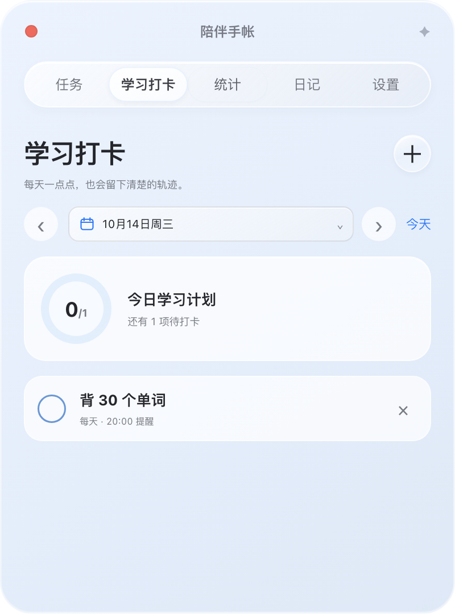
</p>

给自己设置每天（或指定日期）要坚持的小目标，比如「背 30 个单词」，完成后打个勾，还可以设置每天的提醒时间。

### 统计

<p>
  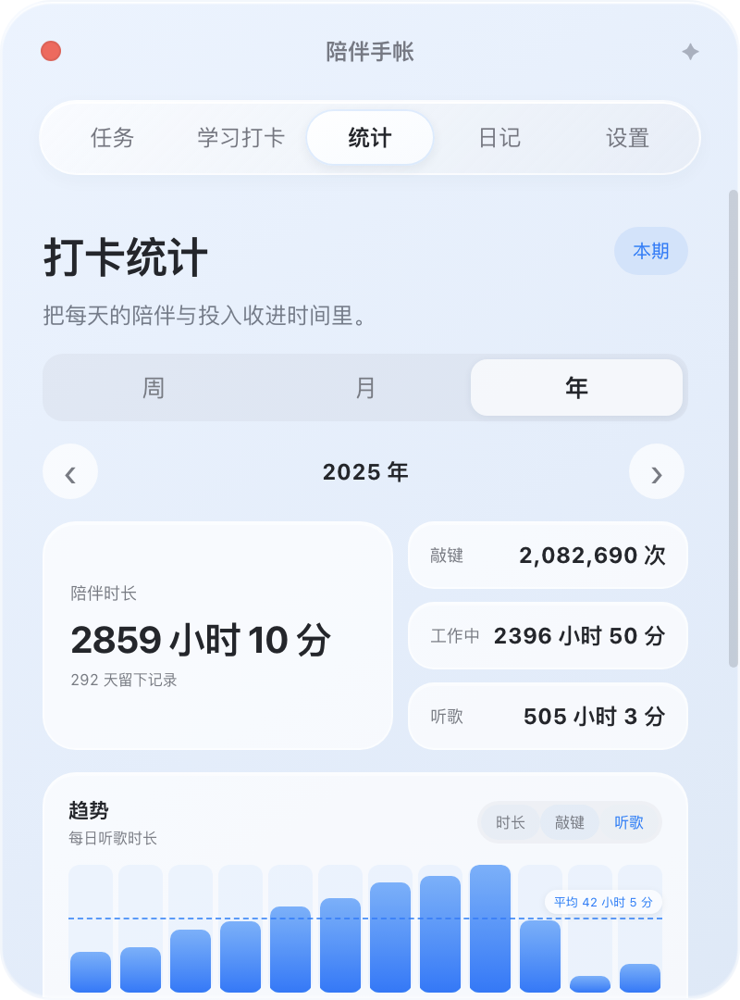
  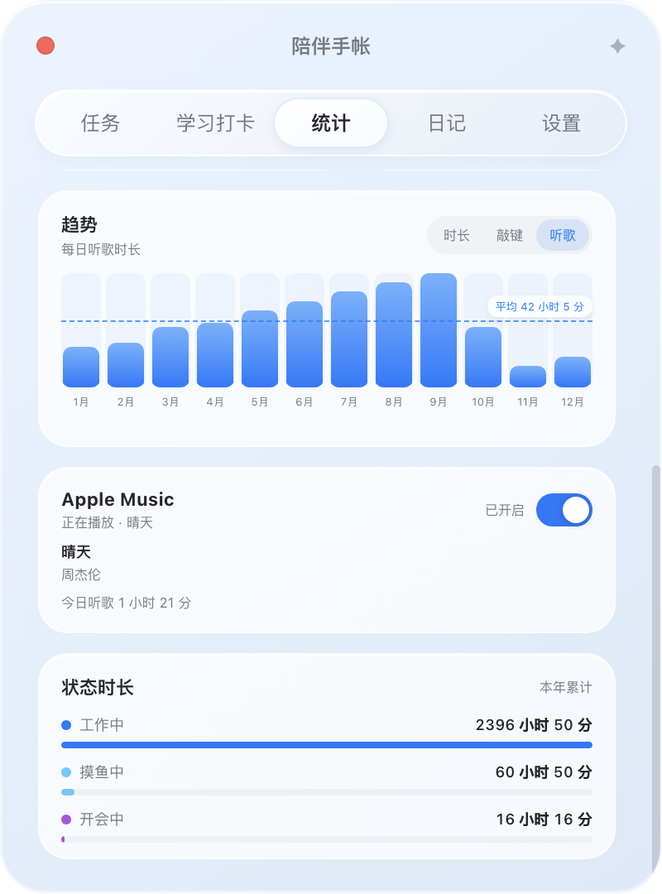
</p>

按周、月、年查看陪伴时长、按键次数和各状态时长的趋势图；打开 Apple Music 开关后，还能看到每天用「音乐」App 听了多久的歌。

### 日记

<p>
  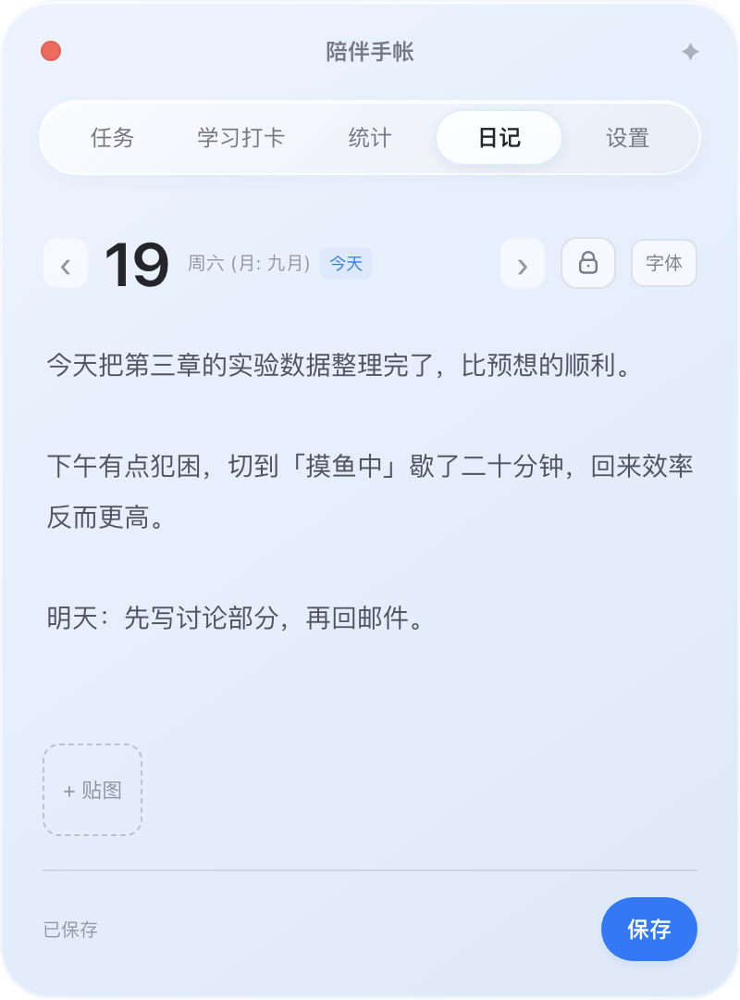
</p>

- 每天一页，自动保存，可以插入图片、切换字体。
- 可以用日历跳到任意一天回看。
- 点小锁可以把正文模糊遮住，旁边有人时也不怕被看到。

### 桌宠形象与贴图库

<p>
  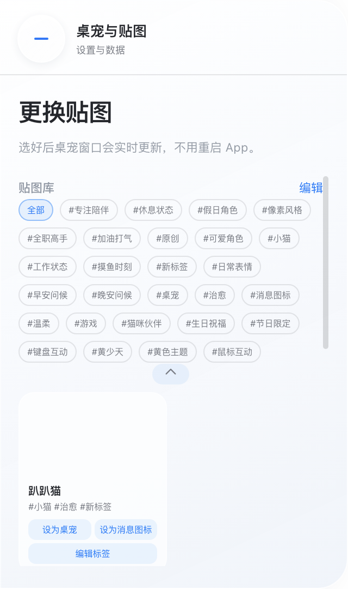
</p>

- 内置一套猫咪形象，也可以上传自己喜欢的透明背景图片（PNG / JPG / WebP / GIF）当桌宠。
- 可以分别设置「待机」（工作中显示）和「休息」（午休、开会、下班等状态显示）两种形象，也可以一张图同时套用。
- 所有图片都放进「贴图库」，可以给它们加标签、按标签筛选。
- 项目自带几张角色贴图，第一次打开时会自动加入贴图库。

### 消息提醒

<p>
  
</p>
<p>
  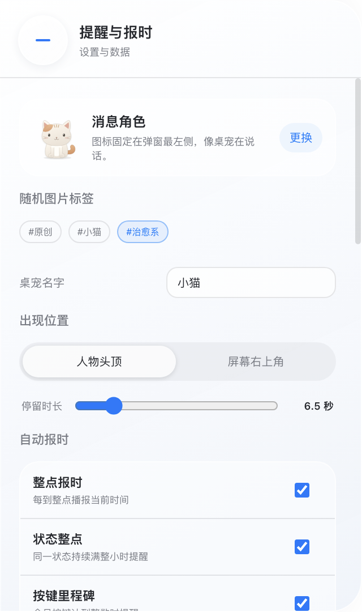
</p>

- 桌宠会以「说话」的样子弹出消息，可以放在桌宠头顶或屏幕右上角。
- 内置整点报时、状态满一小时提醒、按键里程碑（默认每 1000 次）、任务到点、下班总结等消息，文案都可以改。
- 可以自己添加定时消息，并选择工作日、周末或指定星期重复。
- 消息左边的头像可以固定一张，也可以从某个标签里随机抽取。
- 可以给桌宠起名字，消息标题会显示这个名字。

### 自定义状态

<p>
  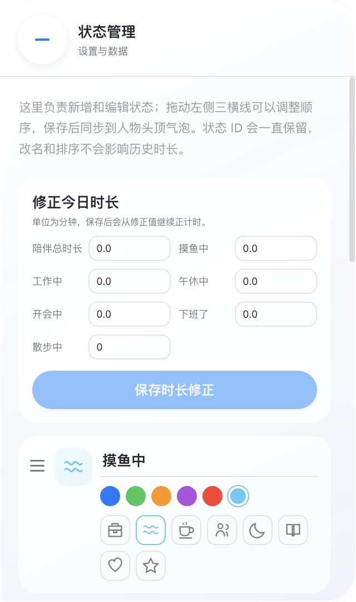
</p>

可以新增状态，或修改任意状态的名称、颜色和图标；改名不会影响已经记录的时长。也可以手动修正今天某个状态的时长。

### 外观

<p>
  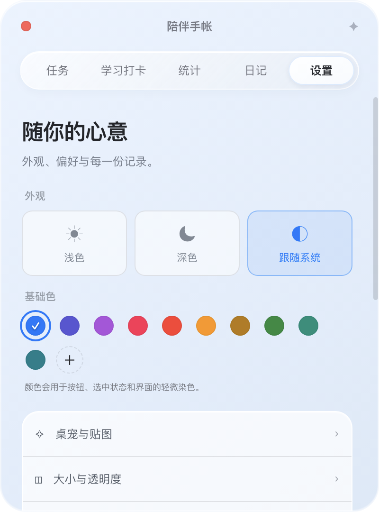
  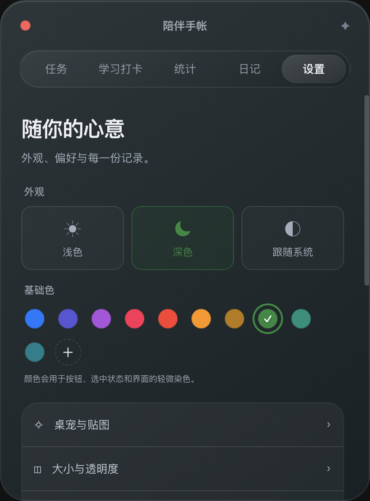
</p>

- 浅色、深色或跟随系统。
- 可选界面主题色，也可以用色盘自选。
- 桌宠大小、桌宠透明度、各个面板的大小和透明度都能单独调节（见下图）。
- 支持开机自动启动。

<p>
  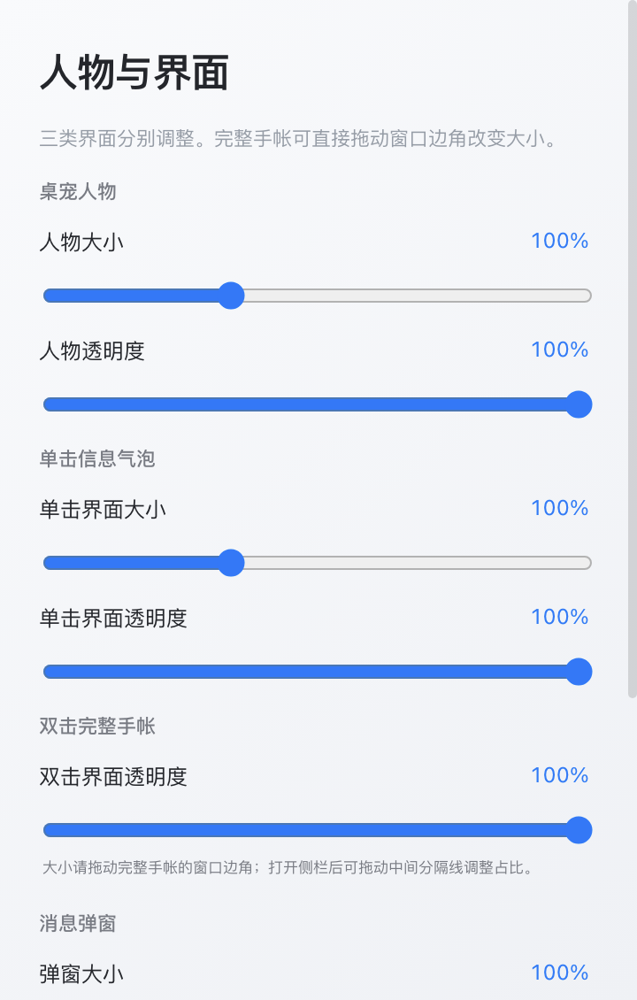
</p>

### 备份与恢复

<p>
  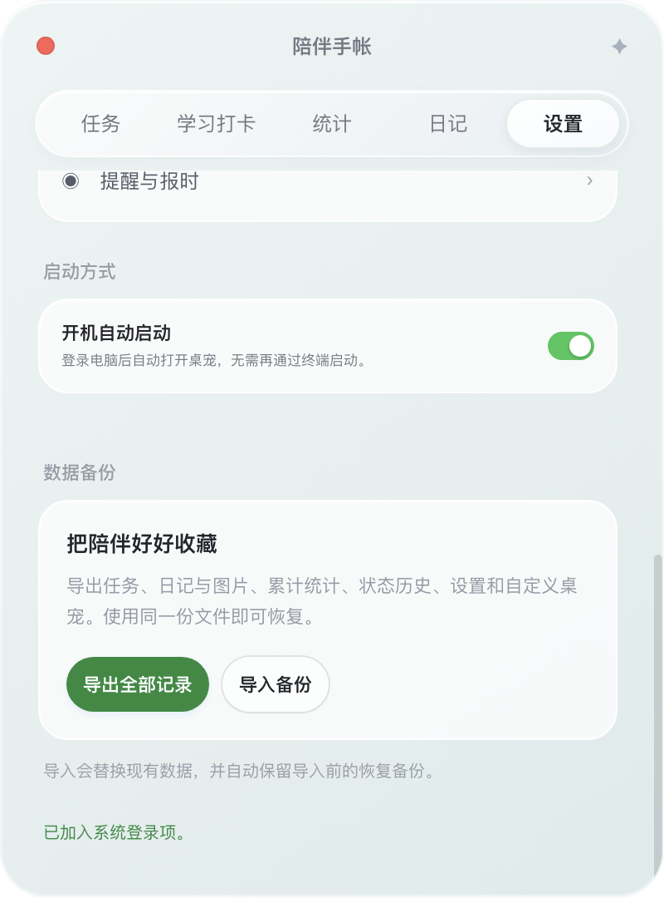
</p>

入口：双击桌宠 → **设置** → 数据备份。

- **导出全部记录**：把统计、状态历史、任务、学习打卡、日记（含图片）、设置和贴图打包成一个 `.json` 文件。换电脑时用它搬家。
- **导入备份**：会先检查文件是否完整，再问你是否替换现有内容；替换前会自动把当前数据另存一份，导入出错会自动回滚。
- 软件升级到新版本时，也会自动先保存一份完整备份。

---

## 你的数据存在哪里

所有数据都只保存在本机：

```text
~/Library/Application Support/study-with-me/
```

想打开这个文件夹：在「访达」里按 `⌘ + ⇧ + G`，粘贴上面这行路径，回车。

其中 `backups/` 文件夹里是导入和升级前自动保存的备份。

---

## 常见问题

### 按键次数一直是 0

1. 确认已在 **系统设置 → 隐私与安全性 → 辅助功能** 中打开 Study With Me（源码运行时是 Electron）。
2. 如果已经打开但仍无效，在列表里选中它，点 **−** 删除，再重新打开软件授权一次。
3. 按键次数要在今天选过状态、并且没有暂停记录时才会统计。

### 提示「已损坏，无法打开」

这是 macOS 对未签名软件的拦截，并不是文件真的坏了。打开「终端」，粘贴下面这行并回车，然后重新打开软件：

```bash
xattr -cr "/Applications/Study With Me.app"
```

### 桌宠找不到了

桌宠第一次会出现在主屏幕的右下角。如果之后找不到了，在「应用程序」里再双击一次 Study With Me，桌宠会出现在你当前所在的桌面上。

### 桌宠挡住了我要点的东西

在托盘菜单里打开「鼠标穿透」，或者直接把桌宠拖到别的位置。

### 怎么退出

点菜单栏的小爪子图标 → **退出**。

---

## 卸载

1. 从菜单栏小爪子图标退出软件。
2. 把「应用程序」里的 **Study With Me** 拖进废纸篓。
3. 如果也想删除所有记录，删除 `~/Library/Application Support/study-with-me/` 文件夹（删除前建议先导出备份）。

---

## 开发者说明

技术栈：Electron + React + TypeScript（electron-vite 构建），全局键盘监听使用 [uiohook-napi](https://github.com/SnosMe/uiohook-napi)，数据存储使用 [electron-store](https://github.com/sindresorhus/electron-store)。

```bash
npm install          # 安装依赖
npm run dev          # 开发模式运行
npm run dev:bg       # 在后台运行开发版（可关闭终端），npm run dev:stop 停止
npm run typecheck    # 类型检查
npm test             # 核心逻辑测试（隔离数据，不读写真实记录）
npm run test:ui      # 在 Electron 中用模拟数据测试真实界面，截图保存在 tests/screenshots/
npm run dist:mac     # 打包 macOS 安装包到 dist/
```

- README 里的配图来自 `npm run test:ui` 生成的截图，全部使用模拟数据。
- 内置贴图由 `resources/sticker-library/manifest.json` 声明，格式见该目录下的 README。
- 公开分发时建议配置 Apple Developer ID 签名与公证，就不会出现「无法验证开发者」提示。

```text
src/main/                  主进程：窗口、托盘、全局输入、数据存储、备份恢复
src/preload/               渲染进程可用的类型化 IPC API
src/shared/                主进程与界面共用的逻辑（日期、统计、提醒规则等）
src/renderer/src/          界面：状态卡、任务、学习打卡、统计、日记、设置、贴图库
src/renderer/public/cat/   默认猫咪形象
resources/sticker-library/ 内置贴图及标签清单
tests/                     核心逻辑测试与界面测试
docs/images/               README 配图
```

## 使用本项目的代码

本项目以 [MIT 许可](LICENSE) 开源，欢迎自由使用、修改和再发布，包括用在商业项目里。MIT 许可只有一个要求，**借用本项目代码时请务必做到**：

1. **注明出处**：在你的项目说明（README）或借用代码的文件开头写明来源，例如：
   > 部分代码来自 Study With Me（附上本仓库链接），MIT 许可。
2. **附上许可声明**：把本项目 [LICENSE](LICENSE) 文件中的版权声明和许可全文一并保留在你的项目里（可以放在 `LICENSE`、`THIRD_PARTY_NOTICES` 或类似文件中）。如果你分发的是打包好的软件，也需要在软件里或随附文件中包含这份声明。

内置贴图（`resources/sticker-library/`）同样随本项目以 MIT 许可提供，使用时遵循同样的要求。

## 第三方许可

- 本项目使用了以下开源项目，它们各自的许可声明随依赖保留在 `node_modules/` 中，打包后的应用里也包含 Electron 与 Chromium 的许可文件：
  - [Electron](https://github.com/electron/electron)（MIT）
  - [React](https://github.com/facebook/react)（MIT）
  - [electron-store](https://github.com/sindresorhus/electron-store)（MIT）
  - [uiohook-napi](https://github.com/SnosMe/uiohook-napi)（MIT）
  - 开发与打包工具：[electron-vite](https://github.com/alex8088/electron-vite)、[electron-builder](https://github.com/electron-userland/electron-builder)、[Vite](https://github.com/vitejs/vite)（MIT），[TypeScript](https://github.com/microsoft/TypeScript)（Apache-2.0）

## 许可证

[MIT](LICENSE) © Study With Me contributors
